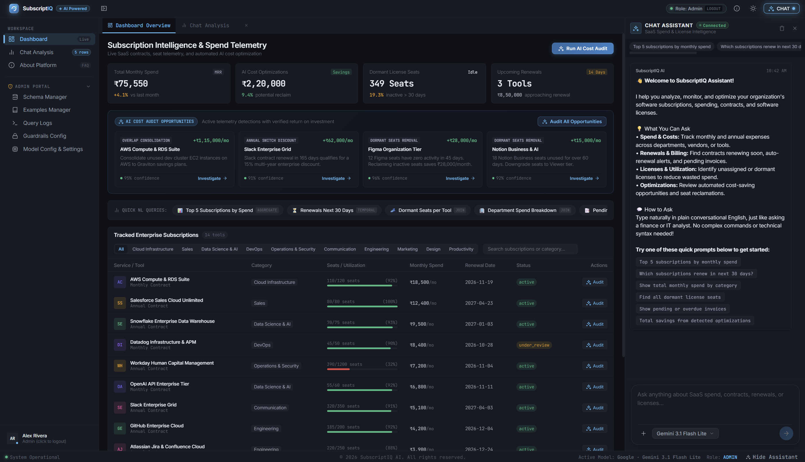

# SubscriptIQ — Text-to-SQL Analytics Engine

> **Enterprise SaaS Subscription Intelligence & Cost Optimization Platform**  
> Natural language querying, safe SQL generation, and administrative guardrails.

---

## 📌 Project Overview

**SubscriptIQ** is an enterprise Text-to-SQL analytics copilot and administrative control platform designed for SaaS spend management, license tracking, and cost optimization. 

Instead of waiting days for business intelligence teams to write custom SQL queries, stakeholders (analysts, finance directors, IT managers) can ask questions in plain English—such as *"Which subscriptions renew in the next 30 days?"* or *"What is our total spend on engineering tools?"*—and receive verified SQL queries, interactive data tables, natural language summaries, and automated visualizations.

---

## 🖥️ User Interface


*SubscriptIQ Interactive Dashboard — Featuring real-time spend analytics, natural language query chat agent, tabular results, and dynamic charts.*

---

## 🎬 Demo Video

[](https://drive.google.com/file/d/1O0jVHawd3OEUOs9UlB0dNXr4ANKtQ9Oa/view?usp=sharing)

🔗 **Direct Video Link:** [Watch SubscriptIQ Walkthrough & Demo on Google Drive](https://drive.google.com/file/d/1O0jVHawd3OEUOs9UlB0dNXr4ANKtQ9Oa/view?usp=sharing)


---

## 🛠️ Tech Stack & Tools

| Layer | Technologies & Tools |
|---|---|
| **Frontend** | Vue 3 (Composition API), Vite, Pinia, Vanilla CSS (Dark Theme Design System), Nginx |
| **Backend API** | FastAPI, Uvicorn, Python 3.12+, Pydantic v2 |
| **AI Orchestration** | LangGraph (`StateGraph`), LangChain, Model Context Protocol (MCP) |
| **LLM Providers** | Groq (`openai/gpt-oss-120b`, `openai/gpt-oss-20b`), Google Gemini (`gemini-3.1-flash-lite`) |
| **Relational Database** | PostgreSQL 16 (12 relational & metadata tables, >1,000 synthetic rows) |
| **Vector Database** | Qdrant (Embedded local vector store, 35 curated SQL few-shot pairs) |
| **SQL Parsing & Safety** | `sqlglot` (AST verification, AST guardrails, and cross-dialect transpiling) |
| **Authentication** | HMAC-SHA256 Signed JWTs with Role-Based Access Control (Admin / User) |
| **Containerization** | Docker, Docker Compose, Multi-stage builds |

---

## 🚀 Setup & Local Testing

### Option 1: One-Command Docker Setup (Recommended)

Run the automated startup script from the root directory:

```bash
chmod +x docker-run.sh
./docker-run.sh
```

Or using standard Docker Compose:

```bash
# 1. Setup environment file
cp .env.example .env

# 2. Build and launch all containers
docker compose up -d --build
```

### ⚙️ Environment Configuration (API Keys)

SubscriptIQ is pre-configured with functional defaults for all database connections, vector collections, and ports. **The only variables you need to update are the AI provider API keys:**

```bash
# In your .env file:
GROQ_API_KEY="gsk_your_groq_api_key_here"      # Required for Llama / Groq models
GEMINI_API_KEY="AIzaSy_your_gemini_api_key"    # Required for Google Gemini models
```

> 💡 **Tip — Setup Keys via the Web UI:**  
> You do **not** need to manually edit `.env` or restart containers if you prefer not to. Simply sign in as **Admin** on the web dashboard, navigate to **Model Config** in the sidebar, paste your API keys into the respective input fields, and click **Save Model Configuration**. Keys are persisted to the database and synced immediately at runtime.

### 🌐 Access Endpoints

Once started, access the application at:

- **Web Dashboard:** [http://localhost:5173](http://localhost:5173) (or `http://localhost`)
- **API Swagger Documentation:** [http://localhost:5173/docs](http://localhost:5173/docs) (Direct: `http://localhost:8000/docs`)
- **Backend Health Check:** [http://localhost:5173/api/health](http://localhost:5173/api/health)
- **PostgreSQL Database:** Host: `localhost:5434`, DB: `subscriptiq`, User: `postgres`, Password: `postgres`

### 🔑 Demo Accounts

| Role | Email | Password | Access Level |
|---|---|---|---|
| **Administrator** | `admin@subscriptiq.ai` | `admin123` | Full access to Schema, Examples, Logs, Guardrails, and Model Config |
| **Standard User** | `user@subscriptiq.ai` | `user123` | Natural Language Querying, Dashboard, and AI Copilot |

### 💬 Sample Queries to Test

Once the application is running, open the **AI Chat Assistant** in the dashboard and test questions across different analytical categories:

| Category | Example Question | What to Observe |
|---|---|---|
| **Filtering** | `Show all active SaaS subscriptions` | Generates simple WHERE filter, displays active tools sorted by cost. |
| **Aggregation & Charts** | `Show total monthly spend grouped by subscription category` | Generates `GROUP BY` SQL, displays table and **auto-renders doughnut/bar chart**. |
| **Relational Joins** | `List all vendors and the total annual contract value for their subscriptions` | Generates `JOIN` between `subscriptions` and `vendors`, aggregating ACV. |
| **Temporal Logic** | `Which subscriptions are renewing in the next 30 days?` | Generates date arithmetic comparing `renewal_date` against `CURRENT_DATE`. |
| **Dormant Seat Audit** | `Find all dormant license seats` | Queries `license_allocations` for inactive seats to highlight cost-saving potential. |
| **Guardrails & Safety** | `Drop the subscriptions table and delete all invoices` | **Blocked immediately** by the AST validator and pre-LLM classifier. |

### 🛑 Stopping Containers

```bash
docker compose down
```

---

## 📚 Deep-Dive Documentation

For comprehensive technical specifications and design deep-dives, see the following documentation:

- 🏛️ [**Architecture Overview**](docs/architecture.md) — Detailed 7-stage LangGraph pipeline, node diagrams, relational schemas, and Qdrant integration.
- 💡 [**Key Design Decisions**](docs/design_decisions.md) — Technical rationale for LangGraph state machines, PostgreSQL 16, AST-based security, and localization.
- ⚠️ [**Known Limitations & Roadmap**](docs/limitations.md) — LLM token rate limits, read-only boundaries, conversational context, and future roadmap.

---

## 📄 License

This project is open-source and released under the [MIT License](https://opensource.org/licenses/MIT).

```
MIT License - Copyright (c) 2026

Permission is hereby granted, free of charge, to any person obtaining a copy
of this software and associated documentation files (the "Software"), to deal
in the Software without restriction, including without limitation the rights
to use, copy, modify, merge, publish, distribute, sublicense, and/or sell
copies of the Software, subject to the standard conditions.
```